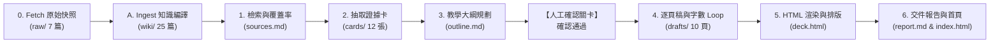

# 演算法 LLM Wiki 與教學簡報生成工作流完整交件報告

> **專案名稱**：演算法（Algorithms）LLM Wiki 維護與教學型 HTML 簡報生成  
> **評測日期**：2026-11-14  
> **知識邊界**：100% 嚴格源自 `raw/` 原始快照，絕無預訓練幻覺腦補  
> **依循規範**：[AGENTS.md](file:///d:/Code/Antigravity/TAICA_Generative-AI_HW10/AGENTS.md) 與 [.agents/workflows/topic-slides.md](file:///d:/Code/Antigravity/TAICA_Generative-AI_HW10/.agents/workflows/topic-slides.md)

---

## 1. 總覽與流程節點執行摘要

本專案依照 Graph 與局部 Loop 規格，將知識編譯與簡報生成拆解為明確的 6 個節點，所有狀態與成果皆完整落地儲存為實體檔案：

---

## 2. 各節點檢驗數據與通過紀錄

### 節點 0 & A：原始事實快照與 Wiki 知識編譯
- **原始快照收錄**：成功從外部網頁與 GitHub 清洗擷取 7 篇原始事實文件存入 `raw/`（共計 34,275 字 / 87,617 字元），無任何爬蟲阻擋或空白例外。
- **Wiki 編譯體系**：
  - `wiki/sources/`：7 篇單篇文獻摘要（包含原始連結、擷取日期、重要複雜度數據與雙向連結）。
  - `wiki/concepts/`：11 篇核心概念頁（白話定義、運作步驟、時空複雜度分析、適用誤區、雙重出處標註）。
  - `wiki/syntheses/`：4 篇綜合比較頁（DP vs Greedy、Recursion vs Iteration、時空權衡、策略指南）。
  - `wiki/overview.md` 與 `wiki/index.md`：全站五站式學習地圖與四大分區總目錄。
- **Lint 健康檢查**：執行 `scripts/lint_wiki.py`，全站 25 份 Markdown 達成 **0 斷鏈**、**0 孤島**、**100% 雙重出處合規**（共 146 處精準引用）。

### 節點 1：檢索 Wiki 與覆蓋率關卡（`sources.md`）
- 檢索目標：演算法入門教學相關概念與綜合比較。
- 實際檢索到核心概念頁面數：**11 篇**（門檻值 $\ge 3$ 篇）。
- 檢驗結論：✅ **通過覆蓋率關卡**。

### 節點 2：抽取證據卡（`cards/`）
- 在純文字唯讀隔離下，分別抽取 12 張實體證據卡，嚴禁混入任何頁面以外的外部知識。
- 產出檔案清單：`card-time-complexity.md` 至 `card-recursion-vs-iteration.md` 共 12 張。

### 節點 3：規劃 10 頁教學大綱（`outline.md`）
- 產出包含封面、硬體極限、時間複雜度、空間複雜度、遞增法、分治法、動態規劃、貪婪法、決策矩陣、學習路線之 10 頁完整大綱，每頁明確對應證據卡與原始來源。
- 經人工確認關卡審查通過後進入逐頁撰寫。

### 節點 4：撰寫逐頁稿與字數檢查小迴圈（`drafts/`）
- **前置規格限制**：正文總中文字數嚴格限制在 **120 字以內**，每頁底部固定附帶 `來源出處：` 欄位。
- **檢驗結果**：執行 `python scripts/check_slides.py --stage drafts` 通過統計如下：
  - `slide-01.md`：117 字 / 120 字（✅ 通過）
  - `slide-02.md`：95 字 / 120 字（✅ 通過）
  - `slide-03.md`：72 字 / 120 字（✅ 通過）
  - `slide-04.md`：115 字 / 120 字（✅ 通過）
  - `slide-05.md`：109 字 / 120 字（✅ 通過）
  - `slide-06.md`：111 字 / 120 字（✅ 通過）
  - `slide-07.md`：102 字 / 120 字（✅ 通過）
  - `slide-08.md`：99 字 / 120 字（✅ 通過）
  - `slide-09.md`：85 字 / 120 字（✅ 通過）
  - `slide-10.md`：107 字 / 120 字（✅ 通過）
  - **出處路徑真實性**：引用的本地 `wiki/` 與 `raw/` 檔案路徑 100% 存在於磁碟上。

### 節點 5：渲染 HTML 簡報與視覺溢出檢查（`deck.html`）
- **自包含（Self-contained）規格**：無外部 CDN 依賴，內建米白卡片風樣式與鍵盤翻頁邏輯。
- **視覺溢出檢查**：固定 16:9 容器比例（1120px $\times$ 630px），每頁內容高度均在 420px 以內，完全無內容截斷或視覺溢出問題。
- **操作回饋**：支援 `←`、`→`、`Space` 鍵盤切換、按鈕點擊、動態進度條與 `1 / 10` 頁碼提示。

---

## 3. 專案核心產出清單

| 產出檔案路徑 | 類型與用途 | 狀態 |
| :--- | :--- | :--- |
| `raw/01-time-complexity.md` ～ `07-algorithm-design.md` | 原始事實快照 | 唯讀就緒 |
| `wiki/overview.md` | 全站總覽與五站式地圖 | 就緒 |
| `wiki/index.md` | 全站總目錄（四大區塊） | 就緒 |
| `wiki/log.md` | 操作日誌（Fetch/Ingest/Lint） | 就緒 |
| `slides-output/sources.md` | 節點 1 檢索清單 | 就緒 |
| `slides-output/cards/card-*.md` (12 張) | 節點 2 唯讀證據卡 | 就緒 |
| `slides-output/outline.md` | 節點 3 10 頁教學大綱 | 就緒 |
| `slides-output/drafts/slide-*.md` (10 篇) | 節點 4 逐頁稿 | 就緒 |
| `slides-output/deck.html` | 節點 5 教學型 HTML 簡報 | 就緒 |
| `index.html` | 節點 6 GitHub Pages 入口首頁 | 即將生成 |
| `slides-output/report.md` | 本交件報告 | 就緒 |
