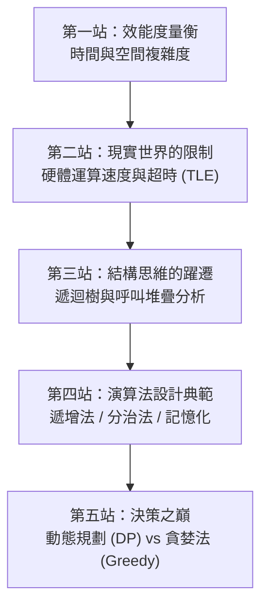

# 演算法 LLM Wiki 全站總覽 (Overview)

歡迎來到面向初學者的**演算法（Algorithms）LLM Wiki**！本知識庫嚴格基於所收錄之原始事實文獻（`raw/`）編譯而成，專門為想要紮實掌握演算法核心思維的學習者打造，並作為後續生成教學型 HTML 簡報的唯一可信知識基石。

---

## 1. 知識庫核心架構與知識防線
本知識庫嚴格遵循「單向事實防線（`raw/` $\to$ `wiki/`）」原則，所有定義、時空複雜度數據、程式碼範例與硬體基準，均 100% 源自以下兩大權威原始文獻群：
1. **LeetCode 演算法效能與底層篇**（Carl 著）：涵蓋時間複雜度、空間複雜度、遞迴演算法時空分析、LeetCode 超時判定機制與 C++ 記憶體消耗對齊。
2. **臺灣師範大學資工系演算法筆記**（Algorithm Design 篇）：涵蓋遞增法、記憶法、枚舉法、分治法、動態規劃、貪婪法等計算機科學演算法設計經典思維策略。

---

## 2. 初學者演算法學習地圖 (Learning Roadmap)

### 第一站：衡量演算法效率的尺（度量衡）
- [時間複雜度與大 O 標記 (Time Complexity & Big-O)](concepts/time-complexity.md)：了解什麼是漸近分析，為什麼常數項與低階項在大規模資料下會被忽略。
- [空間複雜度 (Space Complexity)](concepts/space-complexity.md)：分清程式執行期佔用的動態記憶體與可執行檔體積的差別。
- [程式記憶體配置與對齊 (Memory Management)](concepts/memory-management.md)：認識 Stack、Heap 與硬體記憶體對齊規則。

### 第二站：現實世界的限制與避坑指南
- [超時判定與電腦運算能力估算 (Algorithm Timeout)](concepts/algorithm-timeout.md)：掌握現代評測機每秒約 $10^7 \sim 10^8$ 次操作的物理極限，學會「看輸入數據規模 $n$ 反推演算法複雜度」。

### 第三站：遞迴思維與呼叫堆疊
- [遞迴複雜度分析 (Recursive Complexity Analysis)](concepts/recursive-complexity.md)：掌握「遞迴時間 = 節點總數 $\times$ 單次操作」與「遞迴空間 = 樹的最大深度」。
- [遞迴法與迭代法 (Recursion & Iteration)](concepts/recursion-and-iteration.md)：了解自頂向下與自底向上的哲學差異，防範 Stack Overflow。

### 第四站：經典演算法設計典範 (Paradigms)
- [遞增法 (Incremental Method)](concepts/incremental-method.md)：化整為零，單步累積，以原地交換節省記憶體。
- [記憶化與預先計算 (Memoization)](concepts/memoization.md)：以空間換取時間的經典心法，消除重複計算。
- [分治法 (Divide-and-Conquer Method)](concepts/divide-and-conquer.md)：大問題拆解為互相獨立的子問題，各個擊破後縫合。

### 第五站：高階最佳化決策與綜合對比
- [動態規劃 (Dynamic Programming)](concepts/dynamic-programming.md)：分治法輔以記憶法，專治重疊子問題。
- [貪婪演算法 (Greedy Method)](concepts/greedy-algorithm.md)：每一步只挑局部最佳解，探討貪婪選擇性質。
- [動態規劃 vs 貪婪演算法 (DP vs Greedy)](syntheses/dp-vs-greedy.md)：全域最佳與局部貪婪的決策對比與選型原則。
- [時間與空間的權衡藝術 (Time-Space Tradeoff)](syntheses/time-space-tradeoff.md)：探討如何巧妙運用記憶體換取時間暴升。
- [常見演算法設計典範選擇指南 (Strategies Guide)](syntheses/algorithm-design-strategies.md)：全景決策流程圖與題目選型指南。

---

## 3. 全站目錄導航
查閱所有收錄頁面與一句話摘要，請造訪：[全站總目錄 (wiki/index.md)](index.md)。
