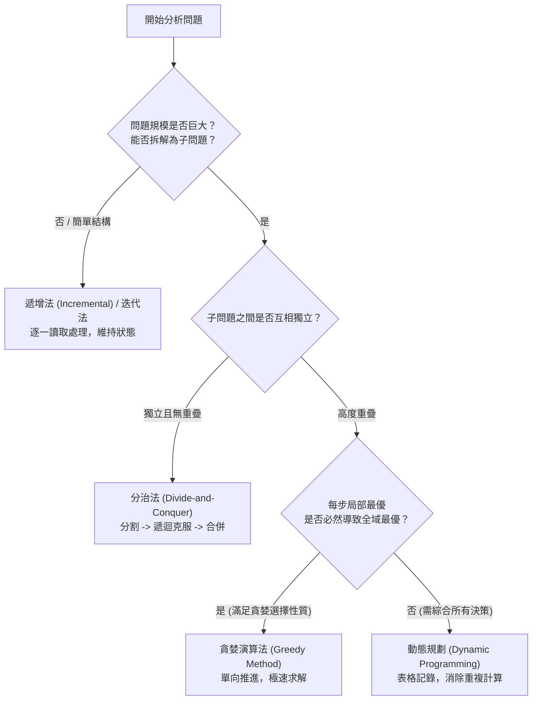

# 綜合比較：常見演算法設計典範選擇指南 (Algorithm Design Strategies Guide)

---

## 1. 核心定位與設計全景圖
在計算機科學中，面對一個具體問題時，如何挑選恰當的演算法思維策略（Algorithm Design Paradigm）是演算法工程師的核心功力。本指南整合自師大資工《演算法筆記》與 LeetCode 實戰架構，提供一份從「問題特性」到「策略選擇」的判別地圖 [來源: raw/07-algorithm-design.md §algorithm design - 演算法筆記 | 原始連結](https://web.ntnu.edu.tw/~algo/AlgorithmDesign.html)。

---

## 2. 五大主流演算法策略對照指南

---

## 3. 各策略核心特徵與適用邊界

| 設計典範 | 核心思維特徵 | 最優時間預期 | 典型適用題目範例 | 致命缺陷或邊界限制 |
| :--- | :--- | :--- | :--- | :--- |
| **遞增法 (Incremental)** | 逐項納入新資料，累積更新結果 [來源: raw/07-algorithm-design.md §incremental method \| 原始連結](https://web.ntnu.edu.tw/~algo/AlgorithmDesign.html) | $O(n)$ 至 $O(n^2)$ | 陣列累加、選擇排序法、單遍掃描區間 [來源: raw/07-algorithm-design.md §範例：選擇排序法（selection sort） \| 原始連結](https://web.ntnu.edu.tw/~algo/AlgorithmDesign.html) | 若無高級資料結構輔助，複雜度容易停留在高階項 |
| **枚舉法 (Enumeration)** | 窮舉所有狀態候選並逐一檢驗 [來源: raw/07-algorithm-design.md §enumeration \| 原始連結](https://web.ntnu.edu.tw/~algo/AlgorithmDesign.html) | $O(n^k)$ 或 $O(2^n)$ | 循序搜尋、平面最近點對暴力解、密碼破解 [來源: raw/07-algorithm-design.md §範例：尋找陣列裡的特定數字 \| 原始連結](https://web.ntnu.edu.tw/~algo/AlgorithmDesign.html) | 容易引發組合爆炸，超時風險最高 |
| **分治法 (Divide & Conquer)** | 大問題切分為獨立子問題分別求解後縫合 [來源: raw/07-algorithm-design.md §divide-and-conquer method \| 原始連結](https://web.ntnu.edu.tw/~algo/AlgorithmDesign.html) | $O(n \log n)$ 或 $O(\log n)$ | 合併排序、快速冪、二分搜尋 [來源: raw/03-recursive-time-complexity.md §依然感觉没有达到极致 \| 原始連結](https://github.com/youngyangyang04/leetcode-master/blob/master/problems/%E5%89%8D%E5%BA%8F/%E9%80%92%E5%BD%92%E7%AE%97%E6%B3%95%E7%9A%84%E6%97%B6%E9%97%B4%E5%A4%8D%E6%9D%82%E5%BA%A6.md) | 若子問題非獨立而是相互重疊，將退化為指數級 |
| **動態規劃 (DP)** | 分治法輔以記憶法，記錄重疊子問題之解 [來源: raw/07-algorithm-design.md §dynamic programming \| 原始連結](https://web.ntnu.edu.tw/~algo/AlgorithmDesign.html) | $O(n^2)$ 或 $O(n)$ | 斐波那契數列、背包問題、最長共同子序列 [來源: raw/05-recursive-complexity-analysis.md §时间复杂度分析 \| 原始連結](https://github.com/youngyangyang04/leetcode-master/blob/master/problems/%E5%89%8D%E5%BA%8F/%E9%80%92%E5%BD%92%E7%AE%97%E6%B3%95%E7%9A%84%E6%97%B6%E9%97%B4%E4%B8%8E%E7%A9%BA%E9%97%B4%E5%A4%8D%E6%9D%82%E5%BA%A6%E5%88%86%E6%9E%90.md) | 需要較高的記憶體空間開闢狀態表格 |
| **貪婪演算法 (Greedy)** | 每一步僅挑選當前看起來最好的局部最優解 [來源: raw/07-algorithm-design.md §greedy method \| 原始連結](https://web.ntnu.edu.tw/~algo/AlgorithmDesign.html) | $O(n)$ 或 $O(n \log n)$ | 活動選擇、標準硬幣找零、最小生成樹 [來源: raw/07-algorithm-design.md §greedy method \| 原始連結](https://web.ntnu.edu.tw/~algo/AlgorithmDesign.html) | 若無貪婪選擇性質，極易陷入局部次優死胡同 |

---

## 4. 資料規模 $n$ 反向選型法則（LeetCode 避坑守則）
根據評測平台每秒約 $10^7 \sim 10^8$ 次基本運算的硬體限制，看題先看測資範圍：
- **$n \le 20$**：可採用回溯法、指數級子集枚舉 [來源: raw/02-algorithm-timeout.md §总结 | 原始連結](https://github.com/youngyangyang04/leetcode-master/blob/master/problems/%E5%89%8D%E5%BA%8F/%E7%AE%97%E6%B3%95%E8%B6%85%E6%97%B6.md)。
- **$n \le 10^3 \sim 10^4$**：可考慮二維動態規劃、平方階雙迴圈 [來源: raw/02-algorithm-timeout.md §总结 | 原始連結](https://github.com/youngyangyang04/leetcode-master/blob/master/problems/%E5%89%8D%E5%BA%8F/%E7%AE%97%E6%B3%95%E8%B6%85%E6%97%B6.md)。
- **$n \le 10^5 \sim 10^6$**：必須控制在 $O(n \log n)$ 內（分治法、貪婪法結合排序）[來源: raw/02-algorithm-timeout.md §总结 | 原始連結](https://github.com/youngyangyang04/leetcode-master/blob/master/problems/%E5%89%8D%E5%BA%8F/%E7%AE%97%E6%B3%95%E8%B6%85%E6%97%B6.md)。
- **$n \ge 10^7$**：只能是線性 $O(n)$（遞增法、滑動窗口）或對數 $O(\log n)$（二分搜尋法）[來源: raw/02-algorithm-timeout.md §总结 | 原始連結](https://github.com/youngyangyang04/leetcode-master/blob/master/problems/%E5%89%8D%E5%BA%8F/%E7%AE%97%E6%B3%95%E8%B6%85%E6%97%B6.md)。

---

## 5. 關聯概念與比較頁面
- [動態規劃 vs 貪婪演算法](dp-vs-greedy.md)
- [遞迴法 vs 迭代法](recursion-vs-iteration.md)
- [時間與空間權衡](time-space-tradeoff.md)
- [超時判定與硬體運算限制](../concepts/algorithm-timeout.md)
